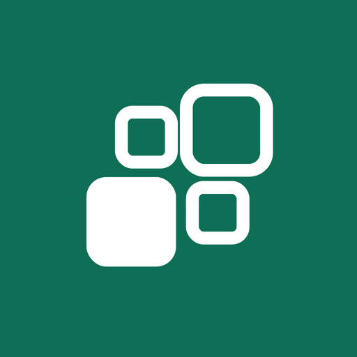

# Flagman S

## English

Flagman S connects your AI assistant to the law of Kazakhstan: legislation in
force, EAEU acts, international treaties and explanations of public authorities,
and — with court-practice access in your Flagman S plan — 17.1 million judicial
documents of first-instance, appellate and cassation courts.

Ask a legal question and get an answer with links to the sources. Open a
particular document, article or paragraph by its Kazakhstan citation and check
whether it is in force. Find a court case by its exact number and read how each
instance decided it. Names of individuals in judicial texts are masked; there is
no case search by surname.

This package contains one legal research skill and the configuration of the
Flagman S remote MCP server. It contains no server code and no credentials.
All five tools are read-only: `search_legal_base`, `list_packages`,
`open_outline_item`, `find_document` and `find_court_case`.

### Access

A Flagman S account with AI access is required. Court-practice search and case
lookup by number need court practice in your plan: an MCP plan with the Judicial
Practice add-on, or a Flagman S legal database plan that already includes
practice. Every tool call counts toward the account's daily request limit.
The plugin sells nothing; plans are arranged on the publisher's website.

### Connect

- **Claude (web, desktop, mobile):** Customize → Connectors → Add custom
  connector, URL `https://api.bestprofi.com/v1/mcp`, then sign in to Flagman S.
- **ChatGPT:** Plugins → Add custom MCP server, URL
  `https://api.bestprofi.com/v1/mcp`, authentication OAuth, then sign in.
- **Claude Code:** `claude mcp add --transport http flagman-s https://api.bestprofi.com/v1/mcp`,
  then `/mcp` → flagman-s → sign in. To try the bundled skill:
  `claude --plugin-dir .`
- **Codex:** `codex mcp add flagman-s --url https://api.bestprofi.com/v1/mcp`,
  then `codex mcp login flagman-s`.

Sign-in uses OAuth 2.1 with PKCE in the host's own window. Never paste a
password or token into a chat or a configuration file.

### Data

The host sends tool arguments — your question or a document or case citation —
to `https://api.bestprofi.com/v1/mcp`, and the server returns legal sources for
the assistant's answer. The publisher does not receive your conversation, files
or documents. See the privacy policy and terms below; the policies of your AI
provider also apply.

### Links

- [Flagman S for your AI](https://api.bestprofi.com/mcp)
- [Support](https://api.bestprofi.com/support)
- [Privacy policy](https://bestprofi.com/legal/privacy)
- [Terms of service](https://bestprofi.com/legal/terms)

## Русский

Flagman S подключает ваш ИИ к праву Казахстана: действующему законодательству,
актам ЕАЭС, международным договорам и разъяснениям госорганов, а при доступе к
судебной практике в тарифе — к 17,1 млн судебных документов первой,
апелляционной и кассационной инстанций.

Задайте правовой вопрос — ответ придёт со ссылками на источники. Откройте
документ, статью или пункт по реквизитам и проверьте, действует ли он. Найдите
дело по точному номеру и прочитайте, как его решала каждая инстанция. Имена
граждан в текстах актов скрыты; поиска дел по фамилии нет.

В пакете — навык работы с правом Казахстана и настройки удалённого MCP-сервера
Flagman S. Кода сервера и учётных данных в нём нет. Все пять инструментов
работают только на чтение.

**Доступ.** Нужна учётная запись Flagman S с доступом к ИИ. Для судебной
практики и поиска дела по номеру практика должна входить в тариф: тариф MCP с
дополнением «Судебная практика» или тариф правовой базы, где она уже есть
(Премиум, Люкс, Платинум). Каждый вызов — запрос из дневного лимита учётной
записи. Тарифы оформляются на сайте; внутри плагина ничего не продаётся.

**Подключение.** Адрес сервера — `https://api.bestprofi.com/v1/mcp`, вход —
через OAuth в окне Flagman S. Пошаговые инструкции для Claude, ChatGPT,
Claude Code и Codex — на [api.bestprofi.com/mcp](https://api.bestprofi.com/mcp),
помощь — на [api.bestprofi.com/support](https://api.bestprofi.com/support).

**Данные.** На сервер уходят только аргументы вызова — вопрос или реквизиты
документа либо дела. Переписку, файлы и документы из чата издатель не получает.

## License

MIT for the files of this package (manifests, skill text, configuration). It
grants no rights to the Flagman S service or its legal and court content. The
Flagman S name and logo belong to ТОО «BestProfi» (BestProfi LLP).
